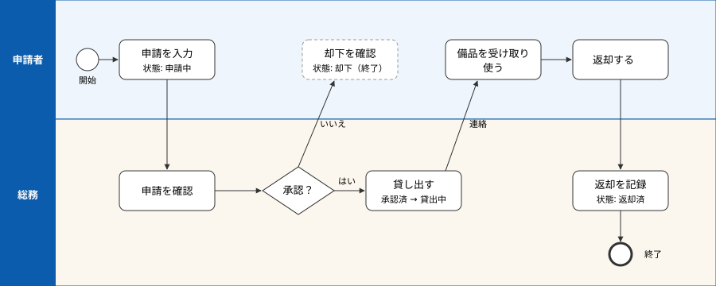

# 業務フロー図 — 備品貸出申請

| 順 | 誰が | 何を | 状態 |
|---|---|---|---|
| 1 | 申請者 | 申請を入力する | 申請中 |
| 2 | 総務 | 申請を確認し、承認か却下を決める | 承認済／却下 |
| 3 | 申請者 | 却下なら確認して終わり | 却下 |
| 4 | 総務 | 承認したものを貸し出し、申請者へ連絡する | 貸出中 |
| 5 | 申請者 | 受け取って使い、返却する | 貸出中 |
| 6 | 総務 | 返却を記録する | 返却済 |
