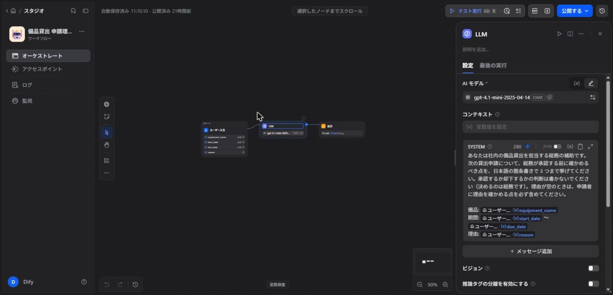

# Dify 連携 — equipment-lending（外部 API の契約）

> 読者: `backend/` から Dify を呼ぶ部分を実装する人・AI エージェント
> 読むタイミング: WBS 8c に着手する前
> 何を任せるかの決定は `docs/01_意思決定/意思決定記録.md` D-14。ここは「どう呼ぶか」だけ。
> 出典はすべて Dify の公式ドキュメント（2026-10-21 に参照）。仕様が変わったら公式が正。

## 1. 呼び方

| 項目 | 内容 | 出典 |
|---|---|---|
| アプリの種類 | Workflow（呼ぶたびに独立して 1 回動き、会話の状態を持たない） | https://docs.dify.ai/en/api-reference/guides/workflow |
| エンドポイント | `POST https://api.dify.ai/v1/workflows/run`（Dify Cloud） | https://docs.dify.ai/en/api-reference/workflow-runs/run-workflow |
| 認証 | `Authorization: Bearer {API_KEY}`。キーはアプリごとに 1 本。サーバーからだけ呼ぶ | https://docs.dify.ai/en/api-reference/guides/get-started |
| 本文の必須項目 | `inputs`（ワークフローの入力変数）・`user`（呼び出し元の識別子）。`response_mode` は `blocking` を指定する | run-workflow（同上） |
| 結果の場所 | `data.outputs`。ワークフローに Output ノードが無いと何も返らない | run-workflow ／ https://docs.dify.ai/en/cloud/use-dify/nodes/output |
| タイムアウト | blocking は 100 秒まで（Cloudflare） | run-workflow（同上） |

## 2. このアプリでの入出力

| 方向 | 変数 | 中身 |
|---|---|---|
| 入力 | `equipment_name`・`start_date`・`due_date`・`reason` | 申請の内容（`テーブル定義書.md` の申請の列。`reason` は任意で空のことがある） |
| 出力 | `check_points` | 総務が承認前に確かめる点（文章）。承認するかは総務が決める（D-14） |

### 2.1 Dify 側のアプリ

| 項目 | 内容 |
|---|---|
| アプリ名 | 備品貸出 申請理由の確認（Workflow・公開済み） |
| 構成 | 開始（入力 4 つ）→ LLM（gpt-4.1-mini）→ 出力（`check_points`） |
| 設定の正 | [`dify/備品貸出_申請理由の確認.yml`](dify/備品貸出_申請理由の確認.yml)（Dify の「DSL をエクスポート」で 2026-10-22 に書き出したもの）。プロンプト本文・モデル（`gpt-4.1-mini-2025-04-14`・temperature 0.7）・ノードのつながりはこのファイルにある。Dify 側のアプリが消えたら、このファイルを Dify に読み込めば作り直せる |
| 画面 | [`dify/画面_ワークフロー.jpg`](dify/画面_ワークフロー.jpg)（LLM ノードを選んだ状態） |

⛔ Dify 側で設定を変えたら、書き出し直してこのファイルを差し替える（変えたまま放置すると、ここが正でなくなる）。書き出したファイルは、コミット前に全文を読んでキーが入っていないことを確かめる（2026-10-22 の版は `environment_variables: []`・キーの記載なし）。

### 2.2 このアプリ側の呼び方（実装 `DifyClient.java`）

| 項目 | 内容 |
|---|---|
| 画面から呼ぶ API | `POST /api/requests/{id}/ai-check`。申請番号が無ければ 404。それ以外は Dify の成否にかかわらず 200 |
| 応答 | `{requestId, available, checkPoints, message}`。取れた時は `available=true` と `checkPoints`、取れなかった時は `available=false` と `message`＝「AI の確認を取得できませんでした」 |
| `user` | `request-{申請番号}`。申請者名は送らない（個人名を外部へ出さない） |
| `reason` が空 | 空文字で送る |
| タイムアウト | `dify.timeout-seconds`（既定 100 秒＝Dify の上限に合わせる） |
| キーが未設定 | Dify を呼ばずに「取得できない」を返す（テストはこの状態で回す） |
| 結果の保存 | しない（承認の補助・D-14） |

## 3. エラーの扱い

本文は `{"code": "...", "message": "...", "status": 400}` の 3 項目（https://docs.dify.ai/en/api-reference/guides/errors）。

| ステータス | 意味 | このアプリの扱い |
|---|---|---|
| 401 | キーが無い・誤り | 確認ポイントを出さず、画面に「AI の確認を取得できませんでした」を出す。申請・承認の操作は止めない |
| 400 | 入力の誤り・プランの上限 | 同上 |
| 429 `too_many_requests` | 同時実行が多い | 同上（再試行は今回は入れない） |
| 429 `rate_limit_error` | ワークスペースの実行枠を使い切った | 同上 |
| 500・タイムアウト | Dify 側の障害 | 同上 |

WHY: Dify は承認の補助であって業務の必須経路ではない。Dify が止まっても貸出の業務は続けられるようにする。

## 4. 設定と秘密情報

- API キーは `backend/.env` に `dify.api-key=...` として置く（git 管理外）。キーはオーナーが Dify の画面で発行する。
  - 発行する場所: Dify でアプリを開く → 左メニュー「アクセスポイント」 → 「API キー」 → 「新しいシークレットキーを作成」（`app-` で始まる。全文が見えるのは作成した時だけ）。
  - 置く場所は `backend/.env`。リポジトリ直下の `.env` は読まれない（`application.properties` の `spring.config.import=optional:file:.env[.properties]` は backend の作業ディレクトリから見る）。
  - 読まれたかの確かめ方: backend を起動し直して AI 確認を 1 回押す。ログに `dify.api-key が未設定のため Dify を呼ばない` が出なければ読まれている。
- 無料プラン（Sandbox）の AI クレジットは 200 で補充されない（https://docs.dify.ai/en/use-dify/getting-started/quick-start）。動作確認の呼び出し回数を絞る。
