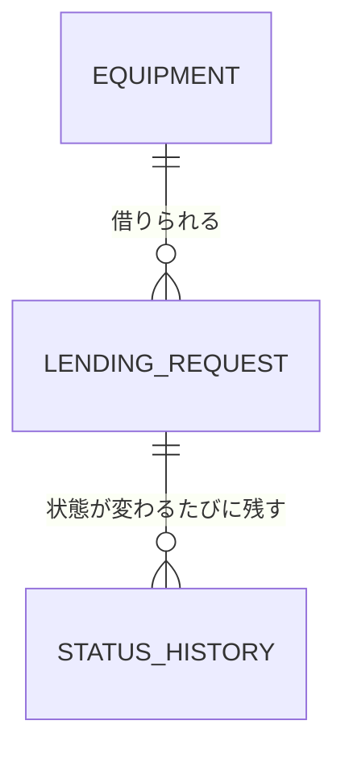

# テーブル定義書 — equipment-lending

> 読者: 実装者・AI エージェント
> 読むタイミング: `backend/` の DB に触れる実装の前

## 正とする定義の宣言

- 実装前の今は**本書が正**。DDL は本書から `backend/src/main/resources/db/migration/V1__init.sql`（Flyway）に起こす。
- DDL ができた後は **DDL が正**、本書は ER 図・WHY・更新責務の索引になる。
- DB は PostgreSQL。**このアプリ専用の DB を新しく作る**（他のプロジェクトの DB と共用しない）。DB 名 `equipment_lending`、接続ユーザー `equipment_app`（所有者）。

## ER図

## テーブル定義

### equipment — 備品

| 列名 | 型 | 制約 | WHY（型・制約の理由） |
|---|---|---|---|
| equipment_id | bigint | PK・`generated always as identity` | 採番を DB に任せ、アプリ側で番号を作らない |
| name | varchar(50) | NOT NULL・UNIQUE | 画面の選択肢に出す名前。同じ名前が 2 つあると選べない |
| created_at | timestamptz | NOT NULL・既定 `now()` | いつ登録したかを残す。時差で迷わないようタイムゾーン付き |

初期データ（`V2__seed_equipment.sql`）: ノート PC／モニター／プロジェクター／会議用マイク（要件定義書 §4）。

### lending_request — 貸出申請

| 列名 | 型 | 制約 | WHY（型・制約の理由） |
|---|---|---|---|
| request_id | bigint | PK・`generated always as identity` | 画面の「申請番号」 |
| applicant_name | varchar(50) | NOT NULL・空文字不可（CHECK `length(trim(applicant_name)) > 0`） | 必須（要件定義書 §5）。模擬なので社員マスタは作らず名前で持つ |
| equipment_id | bigint | NOT NULL・FK → equipment | 自由入力にすると表記ゆれで集計できない |
| start_date | date | NOT NULL | 日単位の貸出なので時刻は要らない |
| due_date | date | NOT NULL・CHECK `due_date >= start_date` | 返却予定日が開始日より前の申請を DB でも止める（画面・API に続く 3 段目） |
| reason | varchar(200) | NULL 可 | 任意・200 字まで（要件定義書 §5）。NULL＝理由の記入なし |
| status | varchar(10) | NOT NULL・CHECK `status in ('REQUESTED','APPROVED','REJECTED','LENT','RETURNED')` | 状態の表（要件定義書 §3）にない値を入れさせない。英字にしたのはコードの列挙型と 1 対 1 にするため |
| version | integer | NOT NULL・既定 0 | 楽観ロック。総務 2 人が同じ申請を同時に承認・却下した時、後の方を 409 にする |
| created_at | timestamptz | NOT NULL・既定 `now()` | 申請日時 |
| updated_at | timestamptz | NOT NULL・既定 `now()` | 最後に状態が変わった日時 |

索引: `(status)` — 一覧の絞り込み（要件定義書 §4）が状態で引くため。

状態の値と画面の表示:

| 値 | 画面 |
|---|---|
| REQUESTED | 申請中 |
| APPROVED | 承認済 |
| REJECTED | 却下 |
| LENT | 貸出中 |
| RETURNED | 返却済 |

### status_history — 状態の履歴

| 列名 | 型 | 制約 | WHY（型・制約の理由） |
|---|---|---|---|
| history_id | bigint | PK・`generated always as identity` | — |
| request_id | bigint | NOT NULL・FK → lending_request | どの申請の履歴か |
| from_status | varchar(10) | NULL 可 | NULL＝申請した時（前の状態がない） |
| to_status | varchar(10) | NOT NULL | 変わった後の状態 |
| changed_at | timestamptz | NOT NULL・既定 `now()` | 業務フローの各段がいつ起きたかを後から追える |

索引: `(request_id)`。

## 更新責務（どの機能が書くか）

| テーブル | INSERT/UPDATE する機能 | 備考 |
|---|---|---|
| equipment | マイグレーション（初期データ）のみ | アプリからは読み取りだけ |
| lending_request | 申請（INSERT）・承認／却下／貸出／返却（status・version・updated_at の UPDATE） | 状態の遷移はサーバーの 1 箇所だけで行う（開発規約 §3） |
| status_history | lending_request を書く同じトランザクションで INSERT | 更新・削除はしない（履歴なので追記のみ） |

## 削除の扱い

行は削除しない。却下・返却済も状態として残す。
