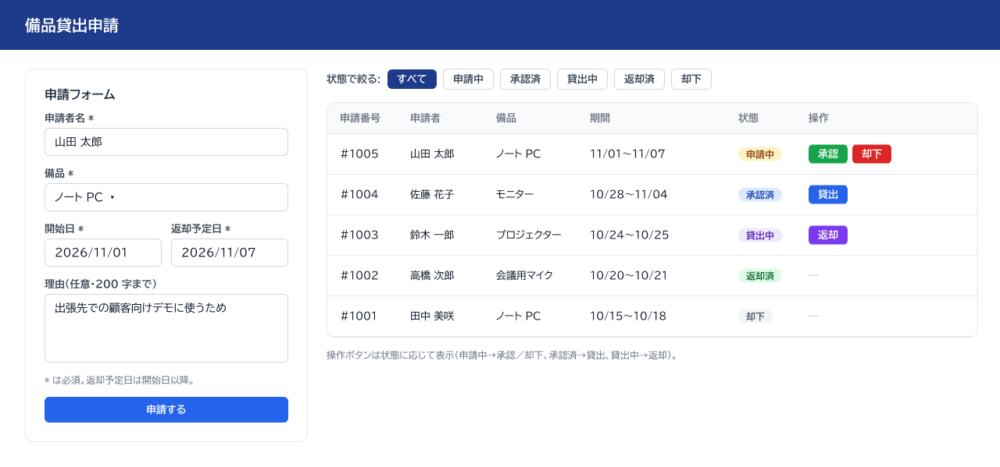

# 画面設計書 — 備品貸出申請（1 画面）

> 画面の項目の正は `docs/02_要求/要件定義書.md` §4。ここは Figma で作った画面の所在と、項目との対応だけを持つ。

## 1. Figma

| 項目 | 値 |
|---|---|
| ファイル | https://www.figma.com/design/KiodFcrn3lGjjFD0spnPsN （フレーム `備品貸出申請（1画面）`・node `2:2`） |
| 作り方 | Claude Code から Figma MCP（リモート版）の `create_new_file` → `use_figma`（Plugin API）で作成 |
| 幅 | 1280px（PC 向け） |
| フォント | BIZ UDPGothic（Regular／Bold） |
| 控え | Figma の「ローカルコピーを保存」で書き出した `.fig`（2026-10-22）を、リポジトリの外（`equipment-lending-backups/`）に置いている。バイナリなのでリポジトリには入れない。Figma 側のファイルが消えたら、この `.fig` を Figma に読み込む |

## 2. キャプチャ

## 3. 要件定義書 §4 との対応

| 区画 | 要件定義書の項目 | 画面での形 |
|---|---|---|
| 申請フォーム | 申請者名・備品・開始日・返却予定日・理由・「申請する」 | 左の枠。必須は `*`。備品はプルダウン（ノート PC／モニター／プロジェクター／会議用マイク）。理由は複数行（200 字まで） |
| 絞り込み | 状態で絞る | 一覧の上のボタン列（すべて／申請中／承認済／貸出中／返却済／却下） |
| 申請一覧 | 申請番号・申請者・備品・期間・状態・操作ボタン | 右の表。状態は色付きのラベル。操作ボタンは状態の表（§3）で次に進める操作だけを出す |

| 状態 | 出す操作ボタン |
|---|---|
| 申請中 | 承認・却下・AI 確認 |
| 承認済 | 貸出 |
| 貸出中 | 返却 |
| 返却済・却下 | なし（終了） |

一覧の行は見本のデータ（架空の氏名）。

## 4. AI 確認（Dify）

| 部品 | Figma の node | 画面での形 |
|---|---|---|
| 「AI 確認」ボタン | `4:2` | 申請中の行の操作列。枠線だけのボタン（承認・却下と色で区別し、状態を進める操作ではないことを見せる） |
| AI の確認ポイント | `4:4` | 押した行のすぐ下に帯で出す。見出しは「AI の確認ポイント（承認するかは総務が決める）」。本文は Dify の返した文をそのまま改行つきで出す。取れなかった時は「AI の確認を取得できませんでした」を赤字で出す |

- 帯の本文は Figma では「（表示例）」として置いた。実際の文は Dify の応答で、保存しない（`docs/04_契約/Dify連携.md`）。
- 承認・却下のボタンは、AI 確認を押したかどうかに関係なく押せる（判断するのは総務）。
